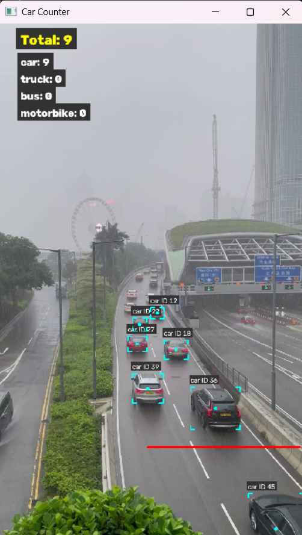
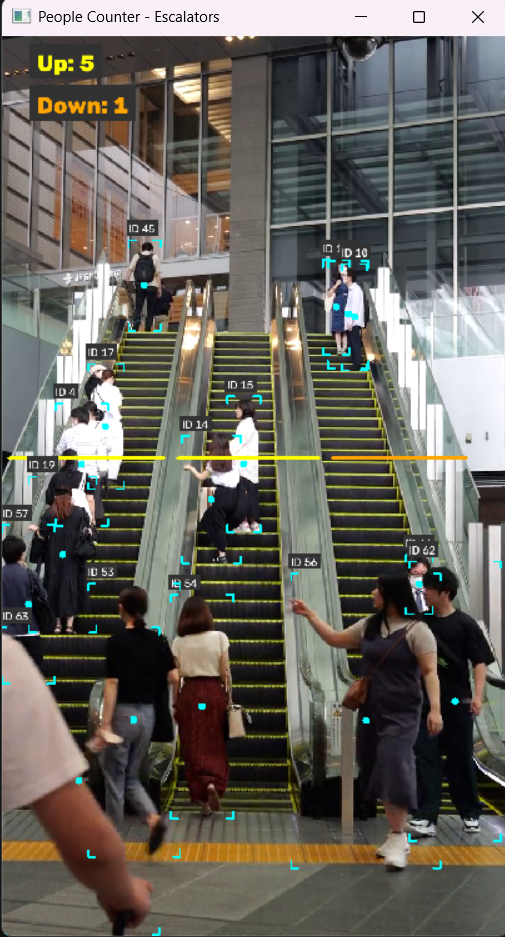
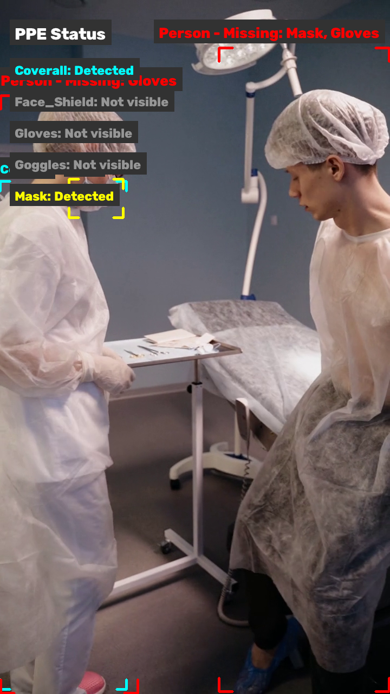
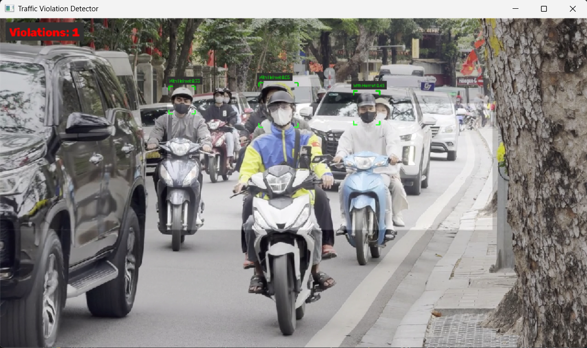
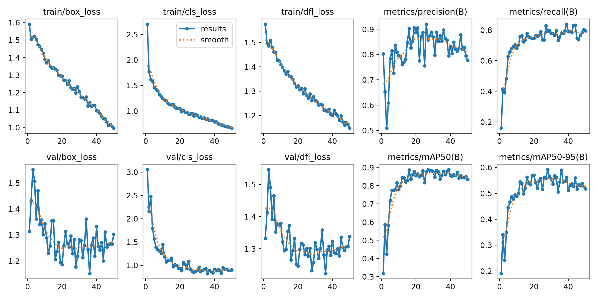

# YOLO Computer Vision Project

Four real-time object-detection applications built with YOLOv8, OpenCV and SORT tracking, covering the full pipeline from custom dataset sourcing and model training (Google Colab) to real-time local inference.

| App | What it does | Model |
|---|---|---|
| **Car Counter** | Counts vehicles crossing a line on a highway video, with a per-class breakdown (car / truck / bus / motorbike) | Pretrained `yolov8n` |
| **People Counter** | Footpath single-line counter, plus a 3-zone escalator up/down counter | Pretrained `yolov8s` |
| **Hospital PPE Detector** | Per-person PPE compliance checking with severity-based violation logging | Custom-trained on CPPE-5 |
| **Traffic Violation Detector** | Detects riders without helmets and counts violations crossing a hand-painted mask zone | Custom-trained on a helmet dataset |

<p align="center">
  
  
  
</p>

<p align="center">
  
</p>

---

## 1. Car Counter


Detects cars, trucks, buses and motorbikes on a highway video, tracks them with SORT, and counts each vehicle once as it crosses a calibrated line, with a per-class breakdown, not just a single total.

```bash
python car_counter/car_counter_final.py
```

**Key techniques**
- SORT tracking gives every vehicle a persistent ID, so nothing is counted twice.
- IoU-based class recovery: SORT discards class labels, so each tracked box is matched back to its nearest original YOLO detection to recover its car / truck / bus / motorbike identity.
- Line position calibrated from a sample video frame (`tools/frame_grabber.py`) rather than guesswork.

---

## 2. People Counter


Two independently working variants for two real-world scenarios.

**Footpath variant**: a single line counting one-directional foot traffic:
```bash
python people_counter/footpath_counter.py
```

**Escalator variant**: three separate counting zones (two "up", one "down") captured from a single camera angle, each zone calibrated with its own coordinates and counted independently by direction:
```bash
python people_counter/people_counter.py
```

Zone coordinates were calibrated with a labeled grid overlay (`tools/grid_frame.py`). Tracking uses the foot position (bottom-centre of each box) rather than the box centre, so counting stays consistent across people of different heights.

---

## 3. Hospital PPE Detector


Detects five PPE categories (Coverall, Face_Shield, Gloves, Goggles, Mask) and performs **per-person compliance checking**, working out what each individual is and isn't wearing, not just whether PPE is visible somewhere in the frame.

```bash
python ppe_detector/ppe_detector.py
```

Controls: `Space` pause · `s` save a full-resolution screenshot · `q` quit. Set `VIDEO_SOURCE = 0` in the script to use a webcam.

**Architecture: two models running together**
1. Pretrained `yolov8n.pt` detects `person`.
2. Custom-trained `ppe_best.pt` detects the five PPE classes.

Each person's box is matched against nearby PPE detections by IoU overlap to decide what that individual is wearing. People missing a required item (Mask, Gloves) get a red box and label; compliant people get a green one.

**Violation logging:** non-compliant sightings are written to `ppe_detector/ppe_violations_log.csv` with a timestamp and severity (missing Mask = HIGH, missing Gloves = MEDIUM), through a reusable `ViolationLogger` with cooldown-based deduplication so an ongoing violation doesn't flood the log.

**Training:** fine-tuned from `yolov8n` for 50 epochs on [CPPE-5](https://link.springer.com/article/10.1007/s42979-023-01748-7), a published medical-PPE dataset, loaded through Hugging Face `datasets` and converted from COCO to YOLO annotation format. Result: **0.885 mAP50** overall on the validation split. Notebook: [`colab_notebooks/train_ppe.ipynb`](colab_notebooks/train_ppe.ipynb).

<details>
<summary>Training curves</summary>

</details>

---

## 4. Traffic Violation Detector


Detects motorcycle riders without helmets and counts violations as they cross a hand-painted counting zone.

```bash
python traffic_violation_detector/traffic_violation_detector.py
```

**Counting with a region mask:** instead of numeric line coordinates, the counting zone is a hand-painted black-and-white image (`traffic_mask.png`). A white shape is painted onto a sample frame to match the real road geometry, and the code does a simple pixel lookup against it, a closer fit to irregular road layouts than rectangles allow. Detections are drawn across the whole frame; only riders whose tracked position enters the white zone are counted.

Each "Without Helmet" rider is tracked with SORT and counted once, and violations are logged to `traffic_violation_detector/traffic_violations_log.csv`.

**Training:** fine-tuned from `yolov8n` for 50 epochs on the public ["Helmet Detection_YOLOv8"](https://universe.roboflow.com/learning-evidence/helmet-detection_yolov8) dataset (With Helmet / Without Helmet). Result: **0.927 mAP50** overall, with **0.894** on the "Without Helmet" class that matters most here. Notebook: [`colab_notebooks/train_traffic.ipynb`](colab_notebooks/train_traffic.ipynb).

---

## Setup

Python 3.11 recommended.

```bash
python -m venv venv
venv\Scripts\activate            # Windows  (macOS/Linux: source venv/bin/activate)
pip install -r requirements.txt
mkdir media\videos               # macOS/Linux: mkdir -p media/videos
```

Core dependencies: `ultralytics`, `opencv-python`, `cvzone`, `filterpy`, `scikit-image`, `lap`. SORT (`utils/sort.py`) is vendored from [abewley/sort](https://github.com/abewley/sort) rather than pip-installed.

Run every command from the project root. Models and videos each app expects:

| App | Models (`models/`) | Video (`media/videos/`) |
|---|---|---|
| Car Counter | `yolov8n.pt` (auto-downloads) | `highway.mp4` |
| People Counter: footpath | `yolov8s.pt` (auto-downloads) | `footpath.mp4` |
| People Counter: escalator | `yolov8s.pt` (auto-downloads) | `escalator.mp4` |
| PPE Detector | `yolov8n.pt` (auto-downloads) + `ppe_best.pt` (included) | `ppe_test.mp4`, or a webcam |
| Traffic Violation | `traffic_best_v2.pt` (included) | `traffic.mp4` |

`yolov8n` is used where speed matters; `yolov8s` is used for the crowded People Counter scenes, where it separates overlapping people better. Demo videos aren't included in the repo (file size),  supply your own footage under the names above.

### Using your own footage

Counting lines and zones are calibrated to the demo videos. For your own footage:
1. Extract a frame with `tools/frame_grabber.py`.
2. Overlay a labeled grid with `tools/grid_frame.py` and read off where the line or zone should sit.
3. Update the coordinates at the top of the relevant script. For the Traffic Violation Detector, paint a new `traffic_mask.png` at the same pixel size as your video frames.

---

## Project Structure

```
YOLO_CV_Project/
├── car_counter/
│   ├── car_counter_final.py           # the working app
│   └── dev_stages/                    # incremental build checkpoints
│       ├── car_counter.py                 (detection only)
│       └── car_counter_tracking.py        (+ SORT tracking, no counting)
├── people_counter/
│   ├── footpath_counter.py
│   └── people_counter.py              # escalator, 3-zone version
├── ppe_detector/
│   ├── ppe_detector.py
│   └── training_results.png
├── traffic_violation_detector/
│   └── traffic_violation_detector.py
├── colab_notebooks/                   # training notebooks (Google Colab)
│   ├── train_ppe.ipynb
│   └── train_traffic.ipynb
├── tools/                             # one-off calibration scripts
│   ├── check_video.py
│   ├── frame_grabber.py
│   ├── frame_resize.py
│   └── grid_frame.py
├── utils/                             # shared app logic
│   ├── constants.py                       (COCO class names, vehicle classes)
│   ├── helpers.py                         (calculate_iou)
│   ├── sort.py                            (SORT tracker)
│   └── violation_logger.py                (CSV logging with cooldown)
├── models/                            # model weights
├── media/videos/                      # input videos (not tracked)
├── docs/screenshots/                  # README images
├── traffic_mask.png                   # hand-painted counting-zone mask
├── requirements.txt
└── .gitignore
```

---

## Workflow

- **Training** (the two custom models only): Google Colab, free GPU tier.
- **Inference** (all four apps): runs locally in VS Code, with no cloud dependency at runtime.

---

## Future Enhancements

- Apply region masking (currently used in the Traffic Violation Detector) to the other counting apps.
- Click-to-draw line and zone calibration, so counting zones can be set interactively instead of hardcoded.
- Expand the PPE training data to sharpen fine-grained class separation.

---

## Credits

- [Ultralytics YOLOv8](https://github.com/ultralytics/ultralytics)
- [SORT](https://github.com/abewley/sort) — Bewley et al.
- [CPPE-5: Medical Personal Protective Equipment Dataset](https://link.springer.com/article/10.1007/s42979-023-01748-7) — Dagli & Shaikh
- ["Helmet Detection_YOLOv8"](https://universe.roboflow.com/learning-evidence/helmet-detection_yolov8) by Learning Evidence, licensed [CC BY 4.0](https://creativecommons.org/licenses/by/4.0/)